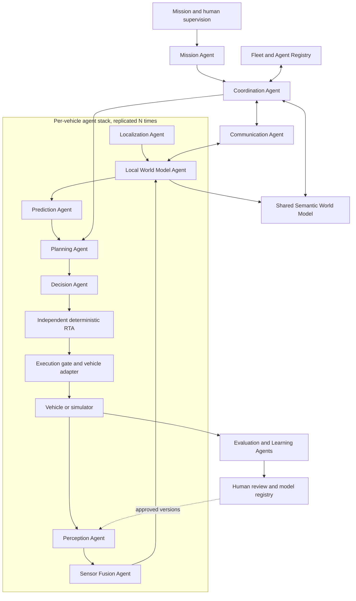

# AutonomyMind

**An agentic autonomy platform for heterogeneous, cooperative fleets.**

AutonomyMind aims to bring autonomous road-vehicle fleets, drones, rovers, aircraft and mobile robots into a common architecture for perception, semantic understanding, mission planning, cooperation and auditable execution. Vehicle count, capabilities, missions, models and simulator adapters are configuration-driven rather than embedded in scenario code.

The long-term architecture is a network of specialized AI agents, coordinated by a Coordination Agent at fleet level, with local agents and independent deterministic runtime assurance (RTA) on each vehicle. Agents can use learned models, classical algorithms or tools behind versioned interfaces. The current reference implementations are predominantly deterministic, not a fully deployed AI-agent fleet.

## Target architecture



The Coordination Agent allocates and renegotiates tasks, reconciles shared observations, and proposes fleet-level deconfliction. It is not a remote actuator authority. Each vehicle retains its own planning, health supervision and safety gate; a missing or stale coordination message must not be interpreted as permission to move. Distributed operation, failover and independently validated fallback behavior are target capabilities, not current guarantees.

## Agent responsibilities

| Agent | Responsibility |
|---|---|
| Mission | Goal decomposition, priorities, task dependencies and progress |
| Coordination | Capability matching, task allocation, conflict negotiation and reassignment |
| Fleet / discovery | Membership, vehicle profiles, health and availability |
| Communication | Versioned events, synchronization, freshness and provenance |
| Perception | Detection, segmentation and free-space observations |
| Fusion and localization | Multi-sensor association, pose and uncertainty |
| World model | Local and shared maps, tracks and semantic memory |
| Prediction | Dynamic-object and peer motion estimates |
| Planning | Model-aware 2D/3D routes, local trajectories and replanning |
| Decision | Candidate ranking and auditable proposals |
| Safety | Safety evidence and deterministic RTA interface, without overriding its result |
| Health / recovery | Fault detection and vehicle-specific fallback requests |
| Dataset / scenario | Licensed data ingestion, normalization and replay |
| Learning / evaluation | Model evaluation, annotation requests and controlled improvement |

These are logical roles; an agent may run locally, at the edge, or in fleet infrastructure. Roles do not imply an implemented LLM, service, or autonomous orchestration runtime today.

## Vehicle and simulator abstraction

| Domain | Reference model / intended adapter | Status |
|---|---|---|
| Road vehicle fleets | Ackermann bicycle; CARLA / traffic simulation | Reference kinematics only; road rules, lanes and CARLA adapter pending |
| Rover / mobile robot | Differential drive, omnidirectional | Reference models; Gazebo rover experiments |
| Drone | Multirotor kinematics; Gazebo / Isaac / SITL | Reference model; live cooperative flight pending |
| Aircraft | Fixed-wing kinematics | Reference model; dynamics and flight integration pending |
| Other vehicles | Model registry extensions | Extension point; VTOL and maritime models pending |

Gazebo Harmonic is the working local simulation reference. Isaac Sim has scene/export and offline exchange assets, not a validated live closed loop. CARLA, SUMO and PX4/ArduPilot SITL are planned adapters, not bundled integrations. Docker and ROS 2 Jazzy are the initial deployment/transport baseline; amd64 and arm64 build targets do not imply hardware validation on all devices.

## Data, scenarios and learning

A planned Dataset & Scenario Engine will ingest licensed external data through source-specific adapters, normalize coordinate frames, time, identities, maps, tracks and provenance, and feed offline replay, evaluation and scenario generation. Waymo Open Dataset Motion is an initial research candidate for road-traffic trajectories and maps; Perception and End-to-End datasets are additional candidates. Road-traffic actors are not assumed to be cooperating autonomous vehicles. V2X datasets and synthetic cooperative scenarios can complement them.

Waymo ingestion is not implemented. Dataset access and use are subject to the applicable [Waymo terms](https://waymo.com/open/terms/); do not ingest or use restricted data for commercial work without appropriate permission. Keep external data, derived artifacts and credentials outside the public repository and track license/provenance per dataset. The Apache license on this code does not grant rights to third-party datasets or models.

The SemanticMap-compatible boundary remains generic: versioned annotation requests, human review, dataset and model registry, evaluation and explicit release approval. No private implementation is bundled. Learning agents must not self-deploy unreviewed safety-critical models.

## Current implementation and evidence

| Capability | Current status |
|---|---|
| Contracts, Python reference runtime, ROS interfaces | Implemented |
| Camera and LiDAR adapters, geometric fusion, reference tracker | Implemented components; full live fused planning pipeline pending |
| Occupancy grid, A*, sampled local navigation | Reference planar planner; unknown space blocked |
| Vehicle registry and fleet allocation | Reference kinematics, external JSON profiles, stale-member handling and pairwise conflicts; not yet integrated with live planner |
| C++ RTA and simulation service | Reference assessment; no certified actuation authority |
| Gazebo static assessment and mobile sensor streams | Exercised on a workstation |
| Gazebo straight-line rover stop | Exercised on a workstation: 1.906 m advance, 44 accepted RTA assessments, LiDAR stop at 1.394 m |
| Gazebo waypoint evasion | Experimental fixed-route regression; not a validated general planner |
| Distributed AI orchestration, fleet-level physical cooperation | Target architecture; not yet implemented end to end |
| Dataset adapters and road fleet simulation | Planned |

The workstation evidence is a reported reference experiment, not a safety certification or a current CI result. In particular, the rover stop was issued by the LiDAR supervisor, not an RTA rejection. No physical vehicle operation is claimed.

## Quick start

```bash
docker compose run --build --rm test
docker compose run --rm contract-check
docker compose run --rm ros-test
docker compose run --rm demo
docker compose run --rm dynamic-demo
docker compose run --rm cooperative-demo
docker compose -f compose.demo.yaml up --build
```

Open the fixture replay dashboard at http://localhost:8080. Keep demo services on trusted local networks. For Gazebo sensor and movement experiments, see [simulation/gazebo/README.md](simulation/gazebo/README.md). These experiments are simulation-only and must not be connected to physical actuators.

For platform-specific builds set `AUTONOMYMIND_PLATFORM=linux/amd64` or `linux/arm64` as appropriate.

## Repository guide

| Path | Purpose |
|---|---|
| `agents/` | Agent role definitions |
| `src/autonomymind_runtime/` | Reference runtime, navigation, vehicle models and fleet core |
| `config/vehicles/` | Illustrative external vehicle profiles |
| `orchestration/` | Contracts, registry, events and observability |
| `autonomy_ws/src/` | ROS interfaces, perception, fusion, tracking and C++ decision/RTA |
| `simulation/gazebo/` | Validated reference scenarios and experimental movement |
| `simulation/isaac/` | Scene assets, export and offline exchange |
| `semantic_data/` | Annotation and dataset integration boundary |
| `tests/` | Unit, integration and end-to-end regression tests |

## Industrial pilot — AutonomyMind Fleet

The first product-oriented milestone is an offline, configurable inspection mission replay with task dependencies, capability allocation, expiring offers and reassignment. It includes aerial, ground and road-logistics members. Synthetic completion events are not physical execution or AI inference.

```bash
docker compose run --build --rm industrial-pilot
```

See [industrial pilot and acceptance gates](docs/industrial-pilot.md).

## Agent Runtime — reference kernel

The first executable in-process agent kernel supports registration, capabilities, event contracts, discovery, expiry and delivery audit. Run `docker compose run --build --rm agent-pilot`. This wraps the offline mission pilot; distributed transport and learned agents remain pending. See [Agent Runtime](docs/agent-runtime.md).

## Distributed agents — DDS reference

Independent mission, coordination and evaluation containers exchange versioned events and capability heartbeats via ROS 2 DDS. This is an offline mission replay, not live robot control or distributed AI inference. See [Distributed Agent Runtime](docs/distributed-agents.md) for build, probe and missing-peer tests.

## Distributed runtime — measured local result

The DDS reference workers passed an end-to-end mission replay on a Linux workstation using host networking and IPC (domain 79): 3/3 synthetic tasks, 4 members, 1 reassignment and 1 rejected stale completion. Use the new standalone host development profile `compose.agents.host.yaml`; see [distributed agents](docs/distributed-agents.md). Multi-host operation and physical cooperation remain unvalidated.

The [advisory model backend interface](docs/model-backends.md) introduces interchangeable model registration and validated candidate ranking. Only a deterministic reference ranker is supplied; learned inference and DDS integration remain pending.

## Optional local AI coordination

A CPU ONNX backend ranks eligible fleet members using a synthetic-trained reference utility model, with verified artifact digest and advisory evidence. See [AI coordination](docs/ai-coordination.md). No learned production policy or live vehicle control is claimed; execution remains to be verified.

## Experimental local LLM / VLM agents

Optional loopback model-server adapters support LLM advisory ranking in the DDS coordinator and VLM semantic scene reports. Models are operator-provided; no learned model execution has been verified. See [local reasoning](docs/local-reasoning.md).

## Shared Semantic World Model

A DDS evidence service now accepts bounded, timestamped metric observations and member states, keeps VLM semantic reports separate, and exposes provenance-aware snapshots with expiry. See [shared world model](docs/shared-world.md). Live sensor producers, cross-source fusion, map exchange and planning consumption remain pending; integration probe not yet executed.

## Cooperative kinematic integration experiment

The configurable reference loop integrates shared evidence, mission allocation, A* and model-specific propagation for heterogeneous vehicles. Run `docker compose run --build --rm cooperative-kinematic`. See [integration scope](docs/cooperative-kinematic.md). No physics simulator, DDS, learned inference or C++ RTA integration is claimed for this experiment; execution pending.

## Multi-vehicle Gazebo RTA assessment

The C++ reference assessment service supports externally configured profile limits and independent namespaced rover/multirotor instances. See [fleet RTA assessment](docs/fleet-rta.md). This is a read-only stationary Gazebo test; no cooperative movement or road-vehicle authorization is claimed.

## Live Gazebo sensor evidence integration

A read-only reference probe projects live simulated LiDAR returns into the independent DDS world model, queries a snapshot, replans A* and submits a first-segment proposal to the C++ rover assessment service. See [sensor-world experiment](docs/sensor-world.md). Execution pending; no autonomous motion or multi-vehicle sensor fusion claimed.

## Collaborative perception reference

Two independent Gazebo sensor producers contribute live simulated LiDAR evidence to a shared DDS world service. A probe checks the occupied-cell union and additional evidence from a second source. See [collaborative perception](docs/collaborative-perception.md). Stationary reference only; operator-reported PASS: 9 rover cells, 8 drone cells, 4 overlapping, 13 total.

## Collaborative route planning

A read-only DDS snapshot consumer compares local-only and shared-evidence A* routes and checks whether remote evidence invalidates a local route. See [collaborative planning](docs/collaborative-planning.md). New probe execution pending; no motion or RTA authorization.

See [reported workstation validation](docs/workstation-validation.md) for experimental results and scope.

## Collaborative planning benchmark

A configurable multi-goal evaluator measures route changes, unchanged routes and unreachable goals from one frozen live evidence snapshot. See [benchmark](docs/collaborative-benchmark.md). Operator-reported PASS: 42 goals, 6 alternatives, 27 unchanged, 1 no shared route, 8 local unreachable.

## Spatiotemporal coordination reference

A bounded advisory scheduler detects continuous piecewise-linear 3D conflicts, schedules departure delays and supports whole-fleet revisions and expiry. See [spatiotemporal coordination](docs/spatiotemporal.md). Offline pilot execution pending; no physical movement authority.

## Documentation

- [Architecture and roadmap](docs/architecture.md)
- [Generic navigation](docs/generic-navigation.md)
- [Multi-vehicle core](docs/multi-vehicle-core.md)
- [Dataset and scenario engine design](docs/dataset-scenario-engine.md)
- [Platform matrix](docs/platforms.md)
- [Testing strategy](docs/testing.md)
- [Vehicle RTA](docs/vehicle-rta.md)
- [Isaac bridge](simulation/isaac/BRIDGE.md)
- [Perception](docs/perception.md)
- [Jetson deployment](deploy/jetson/README.md)

## License

Repository code is distributed under Apache License 2.0; see LICENSE and NOTICE. Third-party components, datasets and models retain their own terms.
