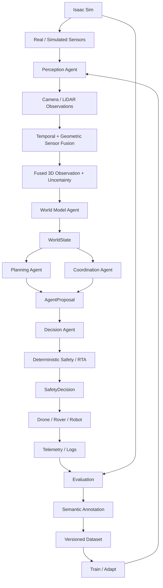
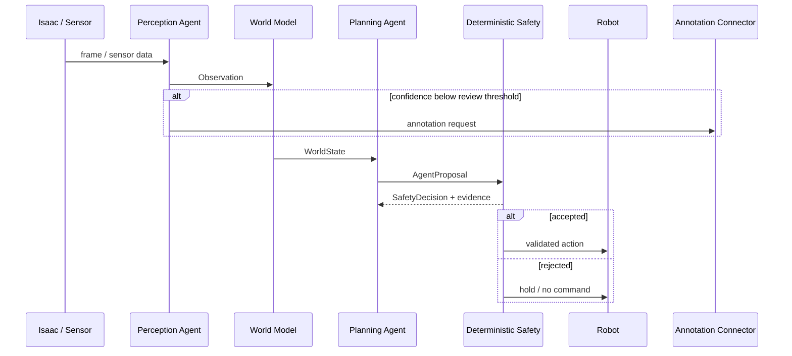
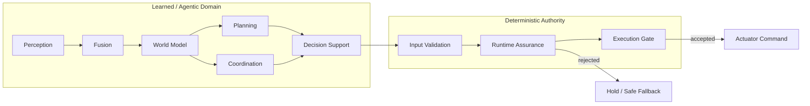
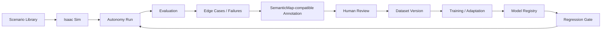
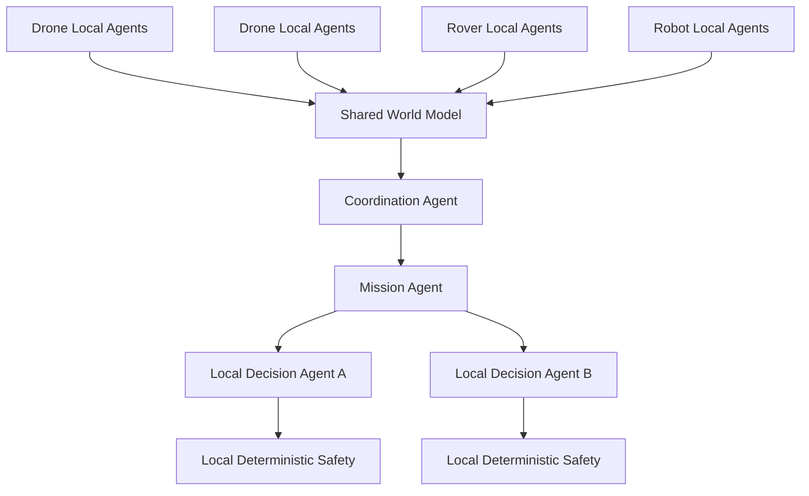
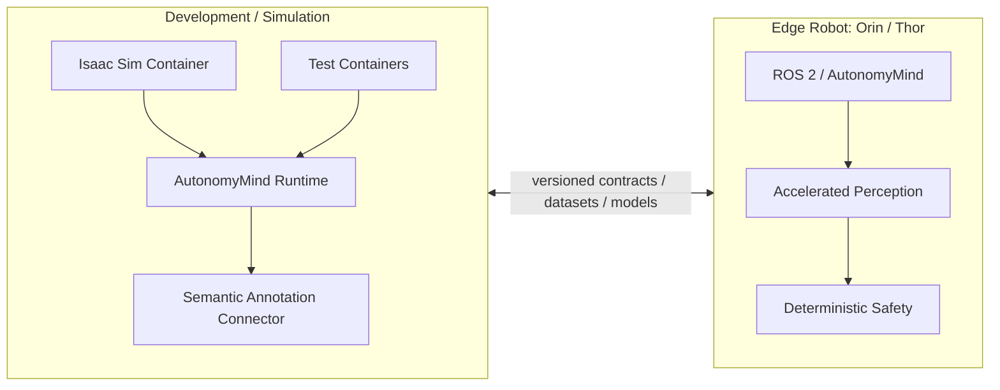
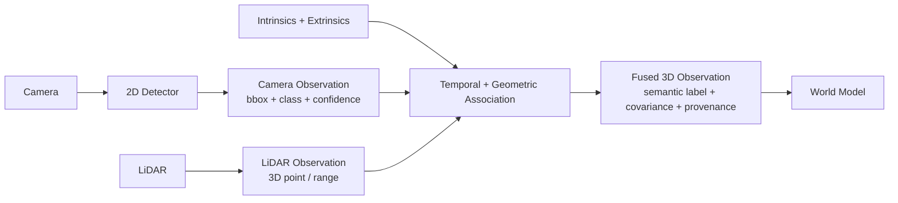
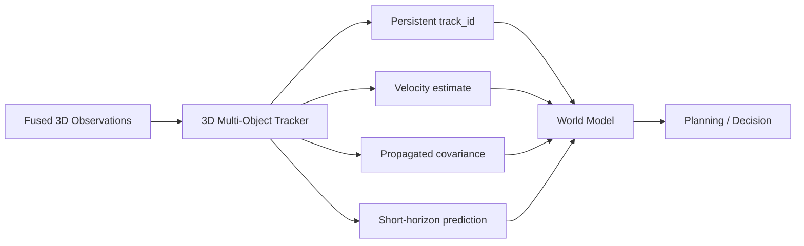
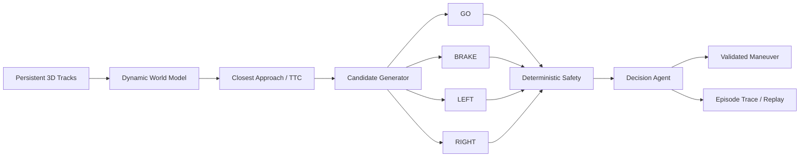
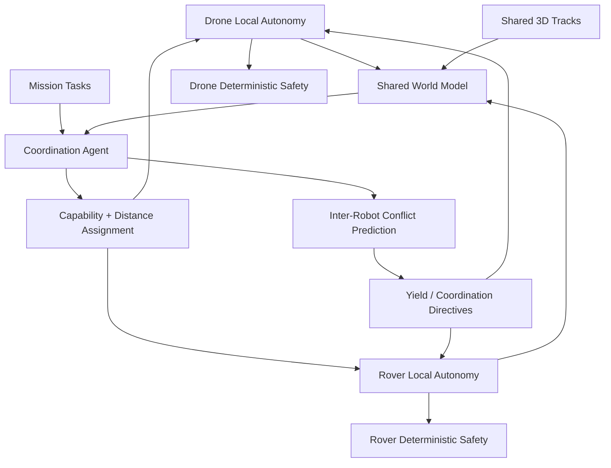

# AutonomyMind Architecture

AutonomyMind is organized as an agentic autonomy stack with deterministic safety boundaries, simulation, and semantic-data feedback.

## 1. System architecture

## 2. Agent contract flow

## 3. Safety boundary

AI components can generate candidates, probabilities, semantic interpretations, explanations, and coordination proposals. They cannot bypass deterministic validation.

## 4. Simulation and learning loop

## 5. Cooperative robotics

Local safety does not depend on permanent connectivity to the shared coordination layer.

## 6. Deployment topology

## 7. Camera + LiDAR fusion

The fusion reference implementation rejects temporally misaligned pairs, transforms LiDAR points into the camera frame, projects them with calibrated intrinsics, associates projected points with 2-D detections, and publishes 3-D observations with explicit uncertainty and provenance.

## 8. Temporal 3D tracking

The reference tracker uses deterministic nearest-neighbor association with constant-velocity prediction, semantic-label compatibility, configurable 3-D gating, one-to-one assignment, and bounded track lifetime. This keeps the public baseline auditable while preserving the contract needed for future probabilistic or learned tracking.

## 9. Dynamic avoidance milestone

The public reference planner evaluates predicted relative motion over a finite horizon, produces multiple transparent candidates, validates them independently, and records the complete decision evidence for replay.

## 10. Cooperative autonomy execution

The shared coordination layer can recommend task allocation and deconfliction, but it does not bypass each vehicle's local deterministic safety authority.
