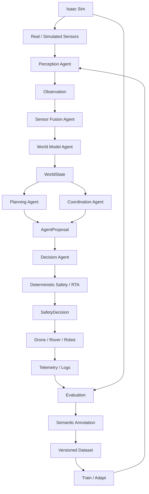
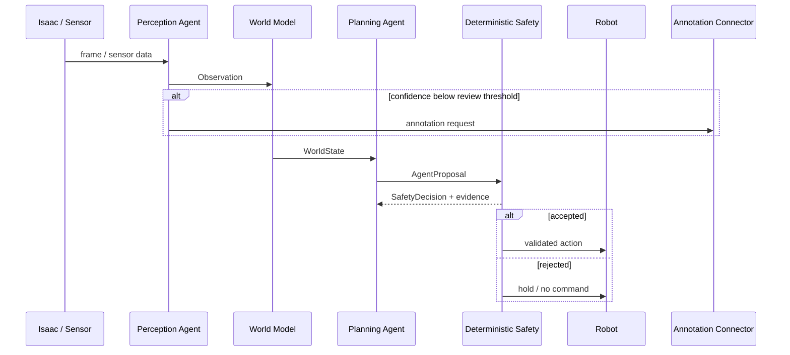
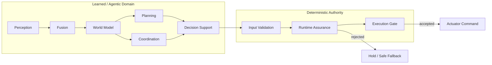
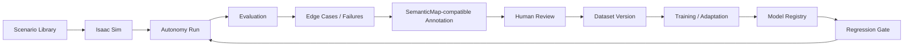
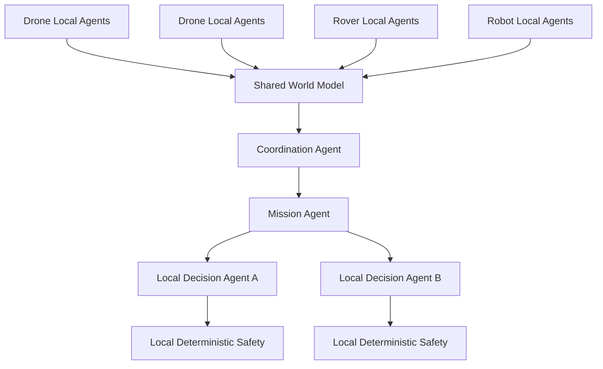
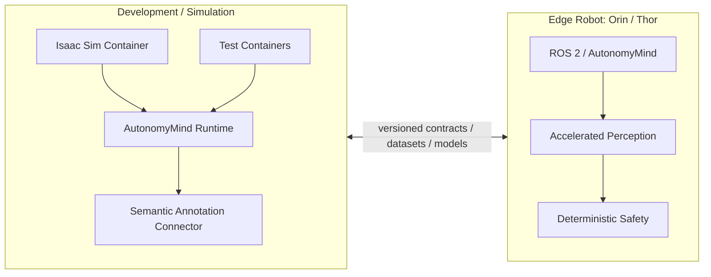

# AutonomyMind Architecture

AutonomyMind is organized as an agentic autonomy stack with deterministic safety boundaries, simulation, and semantic-data feedback.

## 1. System architecture

## 2. Agent contract flow

## 3. Safety boundary

AI components can generate candidates, probabilities, semantic interpretations, explanations, and coordination proposals. They cannot bypass deterministic validation.

## 4. Simulation and learning loop

## 5. Cooperative robotics

Local safety does not depend on permanent connectivity to the shared coordination layer.

## 6. Deployment topology

