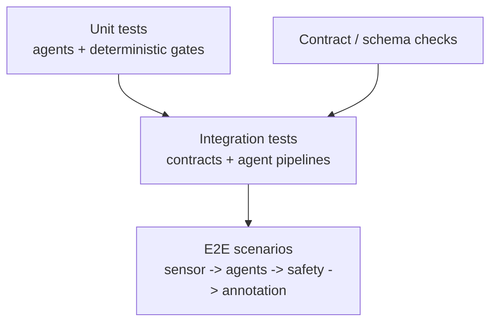

# Verification and test architecture

Every public reference path is intended to be runnable in containers.

## Test pyramid



## Current suites

### Contract checks
- required schemas exist;
- schemas parse as JSON;
- schema version is present.

### Unit
- perception output;
- world-state construction;
- near-obstacle planning fallback;
- deterministic safety acceptance/rejection;
- speed and clearance example gates.

### Integration
- low-confidence observation creates an annotation request;
- high-confidence observation avoids unnecessary annotation;
- proposal and deterministic safety evidence remain linked.

### End-to-end
The obstacle scenario runs three frames:

1. obstacle far away -> forward trajectory proposal;
2. obstacle approaching -> continued evaluated trajectory;
3. obstacle close + low confidence -> HOLD proposal + annotation request.

The final action must be accepted by deterministic safety and the complete provenance chain must be available.

### ROS 2
The ROS Jazzy container builds and tests:
- `autonomymind_interfaces`;
- `autonomymind_decision`.

## Commands

```bash
docker compose run --rm contract-check
docker compose run --rm test
docker compose run --rm ros-test
docker compose run --rm demo
```

## CI gates

A change is releasable only when:

- runtime tests pass on amd64;
- Docker image builds for amd64 and arm64;
- ROS image builds for amd64 and arm64;
- existing decision-core sanitizer tests pass when decision code changes;
- contracts remain parseable and versioned.

Hardware-in-the-loop, Isaac sensor realism, GPU inference accuracy, and real vehicle acceptance are later gates and are not implied by software CI.


## Dynamic obstacle E2E

The dynamic crossing test exercises a moving obstacle across multiple timestamps.

Assertions include:

- persistent track identity in the scenario;
- multiple candidate maneuvers;
- closest-approach conflict estimation;
- deterministic safety result for every candidate;
- selection of an accepted final maneuver;
- reproducible JSONL episode trace.

Run:

```bash
docker compose run --rm dynamic-demo
```
