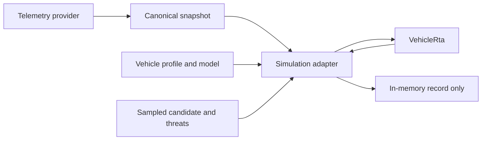

# Vehicle Adapter SDK (reference, simulation only)

The C++ SDK exposes a read-only VehicleTelemetry contract and a SimulationAdapter that records a candidate only after calling VehicleRta. It has no network or actuator output. An assessment is not an executable authorization token.

The reference snapshot binds vehicle identity, kind, sequence, world ENU frame, pose, velocity and health. The recorder checks identity, frame, sequence and matching initial state, rejects re-use of an accepted sequence and invokes the C++ RTA directly. Snapshot age and health are supplied by the caller; this is not a real-time watchdog. Calls must be serialized. A profile and model must be supplied by a trusted integration; no default operational profile is shipped. No physical commands, automatic fallback, arming or mode changes are implemented.

## Integration contracts (not drivers)

| Target | Telemetry inputs | Required normalization and verification |
|---|---|---|
| Isaac Sim | Simulation clock, odometry, sensor health | Common ENU frame, reset/epoch handling, simulation isolation |
| PX4 | Vehicle state, estimator and link health | Explicit NED/FRD to ENU conversion, time synchronization, platform limits |
| ArduPilot | Position, velocity, estimator and link health | Explicit coordinate conversion, vehicle type, timestamps |
| ROS 2 / Nav2 | Odometry, TF, localization and sensor health | World-frame transform, synchronized timestamps, stale data rejection |
| Custom robot | VehicleTelemetry implementation | Units, frame, state quality and independently validated dynamics |

These are integration specifications only. External transport dependencies, live telemetry subscribers, trusted profile registry, independently measured freshness, replay-resistant cross-process authorization and execution adapters require separate implementation and validation. No real-world vehicle connection is authorized by this SDK.

Tests cover accepted simulation recording, wrong vehicle identity, repeated sequence, mismatched initial state, unsafe separation and lost communication.
