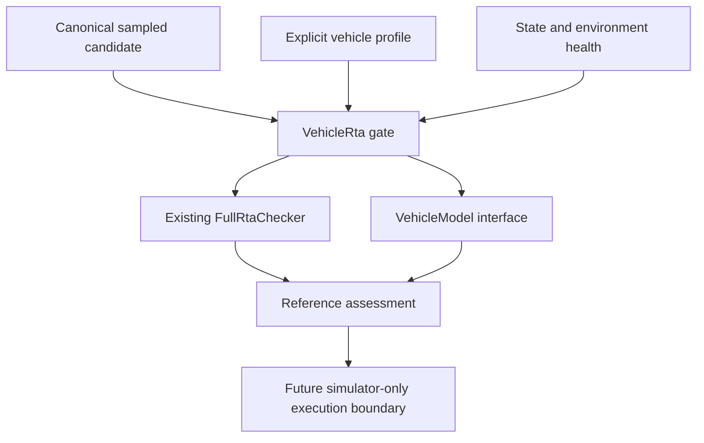

# Vehicle abstraction for Runtime Assurance

The new C++ VehicleRta entry point wraps the existing FullRtaChecker; it does not replace the legacy API.

Profiles are supplied explicitly by the integrator, not inferred from a robot name. The reference model supports fixed wing (minimum horizontal ground speed proxy), multirotor, and flat-ground rover. Generic/legged robots require a custom model implementation. No default operational limits or fallback commands are provided. A custom model can impose extra constraints but cannot bypass common checks.

The gate rejects missing/stale context, invalid profiles, malformed samples and inconsistent candidate trajectories across threats. The initial API requires at least one threat request; it cannot represent verified empty airspace. Health flags and age must come from a trusted upstream source. Samples and reported peak dynamics are not a proof of continuous-time safety. The legacy checker uses a flat terrain plane and point traffic prediction; true airspeed, wind, stopping distance, swept volumes, uncertainty, terrain slope and vehicle-specific dynamics remain to be integrated.

No actuator, autopilot, ROS authorization topic or Python binding is enabled. Rejection means no authorization, not a universal stop command. Contingency policies must be independently validated per vehicle. All tests are synthetic and do not establish flight or ground safety certification.

See [Vehicle Adapter SDK](vehicle-adapter-sdk.md) for the simulation-only recording interface and external telemetry integration contracts.
