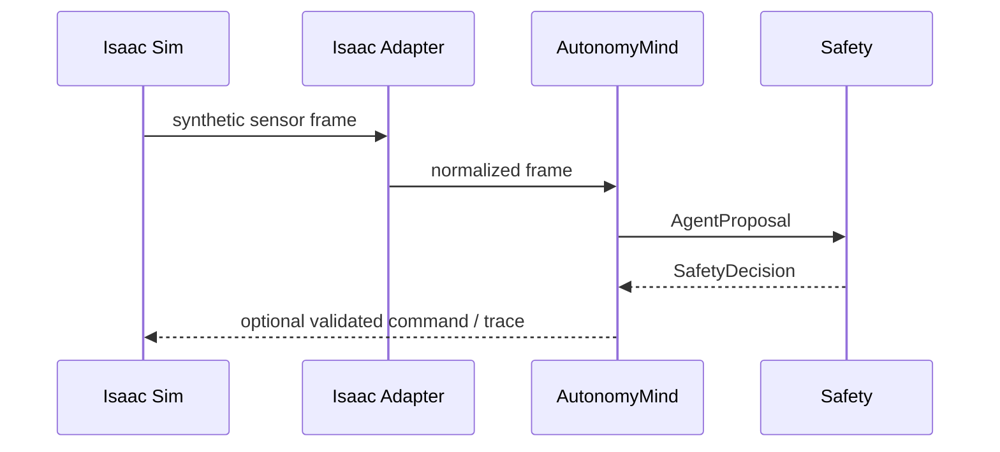

# Isaac Sim bridge

The first integration boundary is intentionally transport-neutral.

Isaac Sim produces scenario/sensor frames into an exchange contract. The same payload can later be transported through ROS 2/DDS without changing the AutonomyMind logical contracts.

## Flow

The checked-in `obstacle_demo.json` is a deterministic contract fixture. It allows CI to test the complete autonomy vertical without requiring Isaac Sim itself to be present in CI.

For real simulation runs, use the NVIDIA container separately and mount `simulation/isaac/exchange/`. Do not vendor NVIDIA simulator binaries or assets into this repository.

## Mission dashboard exchange contract

The dashboard is intentionally independent from Isaac Sim APIs. Isaac can emit mission frames using the same JSON shape as:

`simulation/isaac/scenarios/mission_drone_rover_dynamic.json`

A frame contains:

- `timestamp_s`;
- `robots[]` with pose, velocity, capabilities, and availability;
- `tracks[]` with shared object state;
- `tasks[]` with mission requirements.

An Isaac-side bridge may write those frames to a JSON/JSONL file in `simulation/isaac/exchange/`. AutonomyMind then converts them into the same mission trace consumed by the dashboard.

This separation is deliberate: simulator-version-specific code remains on the Isaac side, while the autonomy, replay, and dashboard contracts remain stable.
